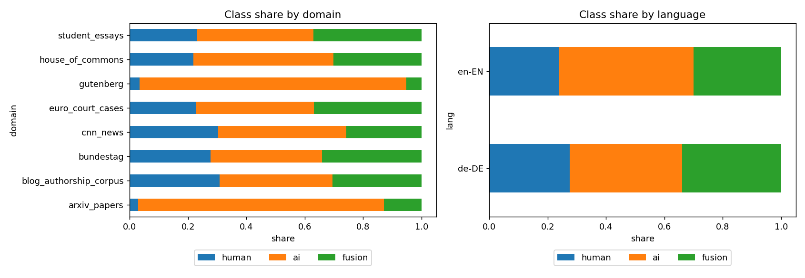
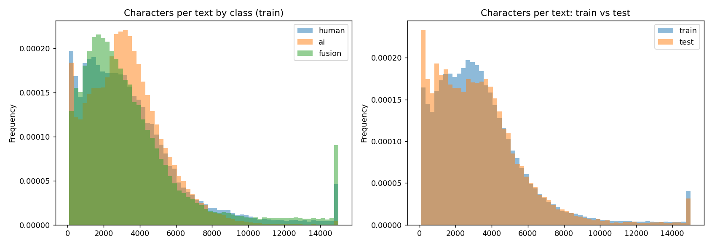
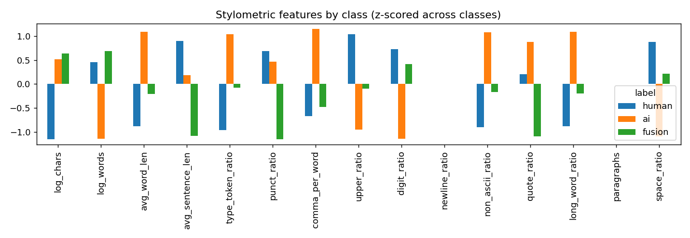
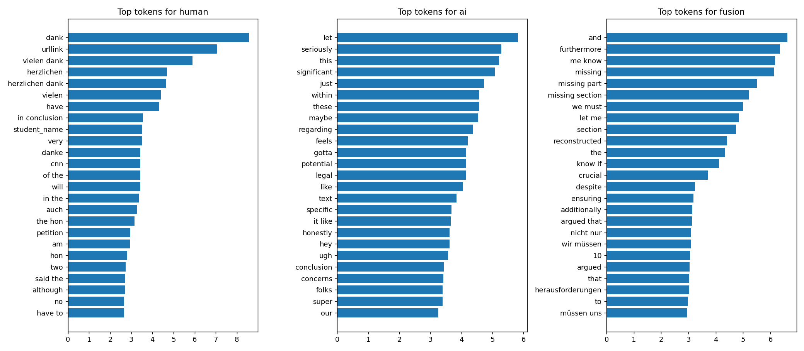
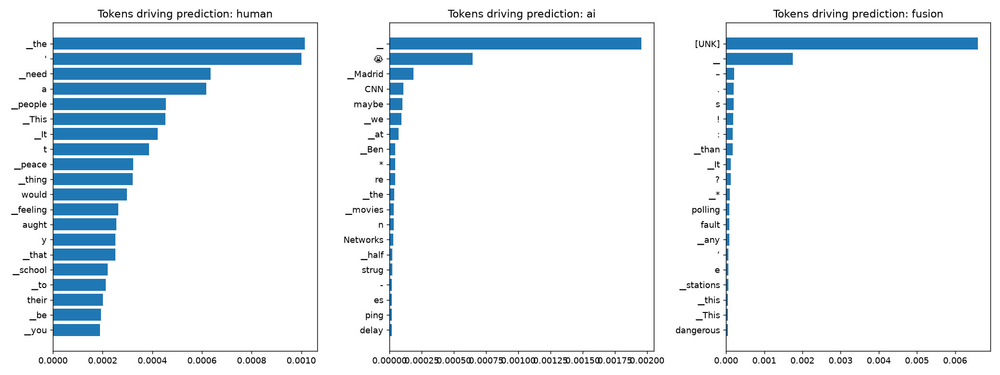

## Вступ

Завдання полягало в тому, щоб для кожного тексту визначити, хто його написав. Класів три: human (текст повністю написала людина), ai (текст повністю згенерувала модель) і fusion (змішаний текст, де частина людська, а частина дописана або переписана моделлю).

У тренувальних даних 272 352 тексти, у тестових 25 000. Тексти англійською та німецькою з восьми джерел: новини CNN, блоги, студентські есе, стенограми Бундестагу і Палати громад, рішення Європейського суду, статті arXiv та книжки з проєкту Gutenberg. Мітки є лише для тренувальної частини, а оцінка йде за macro-F1, тобто середнім F1 по трьох класах, де кожен клас важить однаково.

Головний результат такий. Найпростіша модель на TF-IDF дає 0.861, окремий трансформер, що читає кінець тексту, дає близько 0.92, а комбінація з кількох моделей досягає 0.961 на відкладеній перевірці. Найбільше вирішило не те, яку модель взяти, а те, яку частину тексту їй показати.

## Метод

### Що видно в даних

Класи нерівні: ai - 121 940 текстів, fusion - 83 682, human - 66 730. До того ж у різних джерелах баланс дуже різний. У arXiv 84% текстів позначені як ai, у Gutenberg 91%, а людських там лише 3%. У блогах, новинах і стенограмах класи розподілені значно рівніше.

Довжина текстів сильно залежить від джерела. Блоги короткі (медіана 732 символи), статті arXiv довгі (медіана близько 6 400 символів). За самою довжиною класи майже не відрізняються: медіана 3 112 символів для ai, 2 909 для human і 2 778 для fusin.

Прості стилістичнф ознаки дещо розділяють класи. Тексти ШІ мають довші слова, більше ком і менше цифр та великих літер. Fusion у більшості ознак стоїть між людиною та ШІ, і тому його відрізнити було найважче.

### Як я ділив дані на тренування і перевірку

Тут була найбільша пастка. У даних багато "родичів": один і той самий вихідний текст трапляється кілька разів, д.п. людський оригінал і його fusion-версія. Якщо поділити дані випадково, один родич потрапляє в тренування, а інший у валідацію, і модель частково бачить відповідь заздалегідь. Оцінка тоді виходить завищеною.

Тому я рахував для кожного тексту ключ: хеш перших 200 символів після приведення до нижнього регістру і стискання пробілів. Тексти з однаковим ключем вважаються однією групою і завжди потрапляють в одну частину.

Валідацію склали 15% даних (40 853 тексти), стратифіковано за джерелом, мовою і класом. Для навчання трансформерів я брав дві вибірки, що не перетинаються, по 60 000 текстів з решти даних, причому з них викинув усі тексти, чий ключ трапляється у валідації. Вибірки збалансовані за парою (джерело, клас), щоб великі джерела не задавили малі.

Саму валідацію я ще раз поділив. 7 963 тексти пішли в lock-набір. Це відкладена частина, на якій нічого не налаштовується і яка потрібна тільки для фінальної чесної перевірки. Решта 32 890 текстів (dev) поділена на 5 групових фолдів, тобто так, що жодна група родичів не розривається між фолдами. На цих фолдах навчається і перевіряється фінальний комбінований класифікатор.

### Як рахується метрика

Склад тестового набору за джерелами відрізняється від валідації. Тому крім звичайного macro-F1 я рахував зважений варіант: кожен текст валідації отримує вагу, яка дорівнює відношенню частки його пари (джерело, мова) в тесті до її частки у валідації. Це той самий macro-F1, просто валідація перемішується так, щоб бути схожою на тест. Усі числа нижче наведені саме у зваженому варіанті, якщо не сказано інше.

$$
\text{macro-F1} = \frac{1}{3}\left(F1_{\text{human}} + F1_{\text{ai}} + F1_{\text{fusion}}\right)
$$

### Базова модель

Спершу я зробив просту модель: TF-IDF на словах (одиниці і пари слів) та на символьних n-грамах довжиною від 3 до 5, а поверх них логістична регресія. Пробував також лінійний SVM, але логістична регресія з C = 3 була кращою.

### Трансформери, що читають початок і кінець

Трансформер mDeBERTa-v3-base вміщує 512 токенфв, а більшість текстів довші. Звичайний підхід бере лише початок тексту. Я зробив припузення, що fusion-тексти часто починаються як людські, а шов з ШІ з'являється далі. Тому я подавав моделі початок і кінець разом (head+tail): перші 128 токенів і останні токени до заповнення вікна. Окремі моделі пробували 64 або 256 токенів на початок.

Навчив вісім таких енкодерів: 6 на основі mDeBERTa-v3-base і 2 на xlm-roberta-base, з різними seed, різною довжиною початку і на різних тренувальних вибірках. Кожен навчався 2 епохи з learning rate 2e-5 на 60 000 текстах. Для порівняння я навчив і звичайну модель, яка бачить тільки перші 512 токенів.

Крім того, для двох енкодерів я прогнав сканування всього тексту вікнами по 510 токенів з кроком 255 (до 8 вікон на текст). З імовірностей по вікнах я брав середнє, максимум, мінімум, значення для першого і останнього вікна, кількість вікон і місце, де ймовірність fusion найвища.

Ще один енкодер я дотренував тільки на блогах (32 212 текстів, learning rate 1e-5), бо блоги займають майже 18% тесту.

### Додаткові ознаки

Поряд із трансформерами я рахував кілька дешевих джерел сигналу. Стилістичні ознаки: довжина, середня довжина слова і речення, частка ком, цифр, великих літер тощо. Ознаки "дрейфу": ті самі стилістичні ознаки окремо для першої і останньої третини тексту та їхня різниця, бо в fusion стиль часто змінюється посередині. І ще три TF-IDF моделі, навчені на всьому тексті, лише на початку і лише на кінці.

### Стекінг

Передбачення всіх моделей подавав як ознаки ще одній, фінальній моделі, яка вчиться їх поєднувати. Фінальною моделлю був histogram gradient boosting. На кожному з 5 фолдів внутрішня крос-валідація обирала один з трьох варіантів (логістична регресія, звичайний бустинг або повільніший регуляризований бустинг). Результат на dev рахується тільки на тих фолдах, які модель не бачила, а lock-набір перевіряється окремо.

Я перепробував близько 25 комбінацій джерел і відібрав дві за результатами на dev і на lock. Публічний лідерборд для відбору не використовувався.

## Результати

### Від простої моделі до стекінгу

| Модель | dev | lock |
|---|---|---|
| TF-IDF + логістична регресія | 0.861 | |
| mDeBERTa, тільки початок тексту | 0.876 | |
| mDeBERTa, початок і кінець (найкращий окремий, C) | 0.924 | |
| Стек: модель "тільки початок" + TF-IDF + стиль | 0.923 | 0.922 |
| Стек з 4 енкодерами head+tail і всіма ознаками | 0.957 | 0.956 |
| Те саме + сканування вікнами (кандидат 2) | 0.961 | 0.961 |
| 5 енкодерів + 2 сканування + блоговий енкодер (кандидат 1) | 0.966 | 0.961 |

Для окремих моделей у першій колонці стоїть результат на всій валідації. Для стеків це результат на dev-фолдах, яких модель не бачила.

### Де помиляється базова модель

Базова модель майже ідеально розпізнає чистий ШІ: F1 для ai становить 0.985. Майже всі помилки припадають на плутанину між human і fusion. З 12 552 fusion-текстів 2 572 вона назвала людськими, а з 10 010 людських 1 387 назвала fusion. F1 для human і fusion приблизно 0.81. Тому всі подальші кроки були спрямовані саме на fusion.

### Кінець тексту важливіший за початок

Перехід від моделі, що читає тільки початок, до моделі, що читає початок і кінець, дав найбільший стрибок: з 0.876 до 0.92. Це підтверджується двома незалежними способами. TF-IDF, навчений лише на кінці тексту, дає 0.780, а навчений лише на початку 0.751. А в поясненнях трансформера (integrated gradients) кінцева частина вікна отримує 67% внеску для fusion і 69% для human, тоді як для ai розподіл ближчий до рівного (56% на кінець).

Варіанти енкодерів між собою відрізняються мало, від 0.910 до 0.924. Найкраще працювала модель C, у якої 256 токенів на початок. Але різні енкодери помиляються по-різному, тому в стеку вони добре доповнюють одне одного: чотири енкодери head+tail самі по собі дають 0.940 на dev, а з додатковими ознаками 0.957.

### Що вивчила лінійна модель

Найвагоміші слова лінійної моделі показують, що вона частково вивчила особливості джерел, а не стиль автора. Для класу human серед топових ознак "vielen dank" і "herzlichen dank" (подяки зі стенограм Бундестагу), "urllink" (службова позначка з блогів), "student_name" (заглушка з есе) і "cnn". Для fusion з'являються "missing part", "missing section" і "reconstructed", що схоже на залишки інструкцій, якими генерували змішані тексти. Для ai натомість видно справжній стиль моделей: "significant", "potential", "regarding", "honestly", "folks".

Графік токенів для трансформера інтерпретувати майже неможливо. Нагорі стоять службові токени [UNK], окремий пробіл і емодзі, а внески дуже малі. З цього аналізу корисним виявився лише розподіл внеску між початком і кінцем, описаний вище.

### Фінальні кандидати

Кандидат 1 (стек з п'ятьма енкодерами, двома скануваннями і блоговим енкодером) має 0.966 на dev і 0.961 на lock. Кандидат 2 (чотири енкодери і одне сканування) має 0.961 і на dev, і на lock, тобто поводиться найстабільніше. Файл кандидата 2 після відбору отримав 0.96148 на публічному лідерборді, що майже точно збігається з оцінкою на lock.

### Перевірки на витік і перенавчання

Я перевірив, що тренувальні вибірки всіх моделей не мають з валідацією спільних id, ключів чи однакових текстів, а dev, lock і фолди не мають спільних ключів. Коли я перемішав мітки, стек отримав macro-F1 0.27, тобто рівень випадкового вгадування, отже жодна ознака не містить відповіді напряму.

На своїх тренувальних рядках фінальна модель має 1.0, а на небачених 0.961–0.966, тому в звіті наведені лише останні числа. Оскільки найкращий стек обирався з приблизно 25 варіантів на тих самих даних, оцінка трохи завищена, приблизно на 0.001–0.002.

Ще 994 тексти валідації (2.4%, майже всі fusion) мають такі самі останні 200 символів, як тексти з тренування. Модель на них не працює краще, ніж на інших, а в тесті таких текстів майже немає.

Нарешті, я перезапустив фінальний етап обох кандидатів зі збережених виходів енкодерів. Імовірності, оцінки й файли сабмішенів збіглися повністю. Самі енкодери в цій перевірці заново не навчалися.

## Висновок

Найбільше на результат вплинули дві речі. Перша: чесний поділ даних з урахуванням родичів. Без нього всі оцінки були б завищеними, і порівняння моделей мало б мало сенсу. Друга: показувати трансформеру не тільки початок, а й кінець тексту, бо ознаки змішаного тексту з'являються переважно ближче до кінця.

Чистий ШІ розпізнати легко, а вся складність у тому, щоб відрізнити людський текст від частково переписаного. Стекінг кількох різних енкодерів і дешевих ознак підняв результат з 0.92 до 0.961 на відкладеному наборі. Водночас аналіз лінійної моделі показав, що частина сигналу йде від особливостей конкретних джерел, а не від стилю автора, тож на текстах з інших джерел якість, скоріше за все, буде нижчою.
